# Remote Gaming P1.6 visual review

Staging candidate `v0.4.5-rc.2` was captured at `6ecfe39304ebf57d092432d97872f1d5bb30f8c5`. Before captures come from the original `v0.4.4` comparison at `04d6bf58045b40b47eaf19d272507a265ce20b25`. Desktop is 1440 CSS px and mobile is 390 CSS px. Select any image to open its full-resolution PNG.

The directory, Modern Art entry and Pandemic status candidate captures were taken on hosted staging while signed out. The authenticated Modern Art lobby, tabletop and account-control captures were taken locally in Chromium using the relevant source revision and disposable Auth and gameplay fixtures. The baseline hosted images are preserved as supplied. The two mobile baseline entry captures contain identical pixels.

The candidate review records a long identifier clipping in the tabletop title at 390 CSS px. The lobby session link wraps. The tabletop uses 52% outer and 32% nested fills, with 12 px, 8 px and 6 px shared corner radii. The tabletop scroll screenshots show the pinned navigation and content fade.

## Directory

Hosted entry captures.

| Viewport | Before | Candidate | Candidate hover |
| --- | --- | --- | --- |
| 1440 CSS px |  | [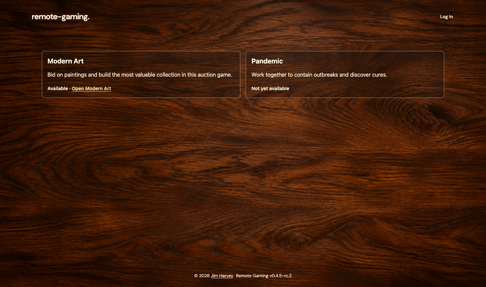](directory-desktop.png) |  |
| 390 CSS px | [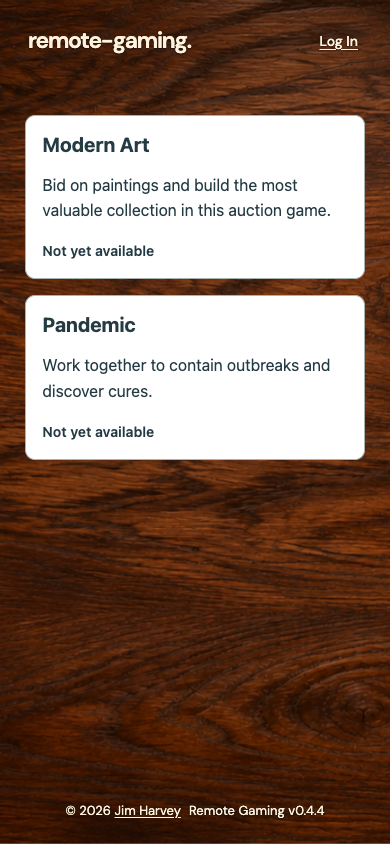](before-directory-mobile.png) |  |  |

## Modern Art entry

Hosted entry captures.

| Viewport | Before | Candidate | Candidate hover |
| --- | --- | --- | --- |
| 1440 CSS px | [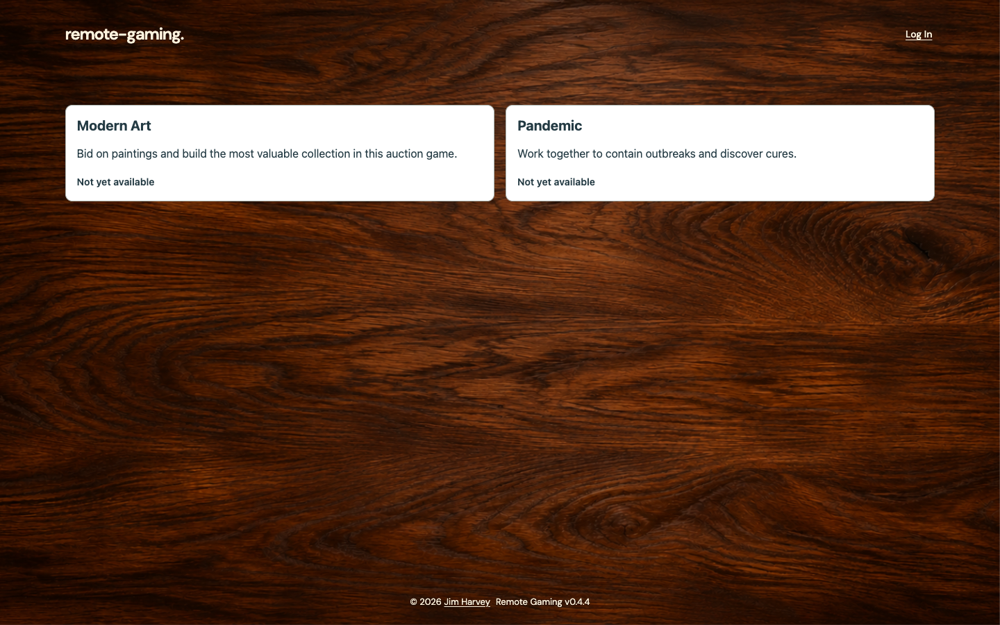](before-modern-art-entry-desktop.png) |  | [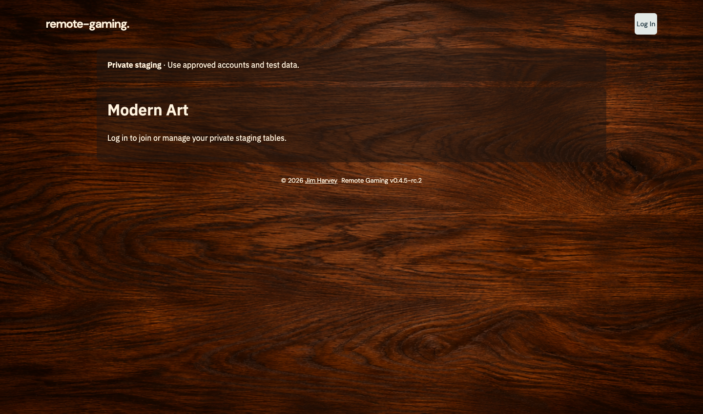](modern-art-entry-desktop-login-hover.png) |
| 390 CSS px |  |  |  |

## Modern Art lobby

Authenticated disposable fixtures. The candidate images also show the account control in its default state.

| Viewport | Before | Candidate |
| --- | --- | --- |
| 1440 CSS px | [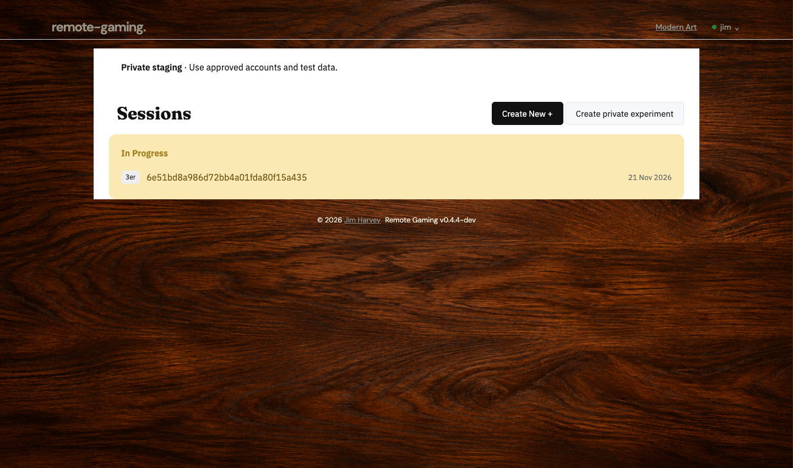](before-modern-art-lobby-desktop.png) | [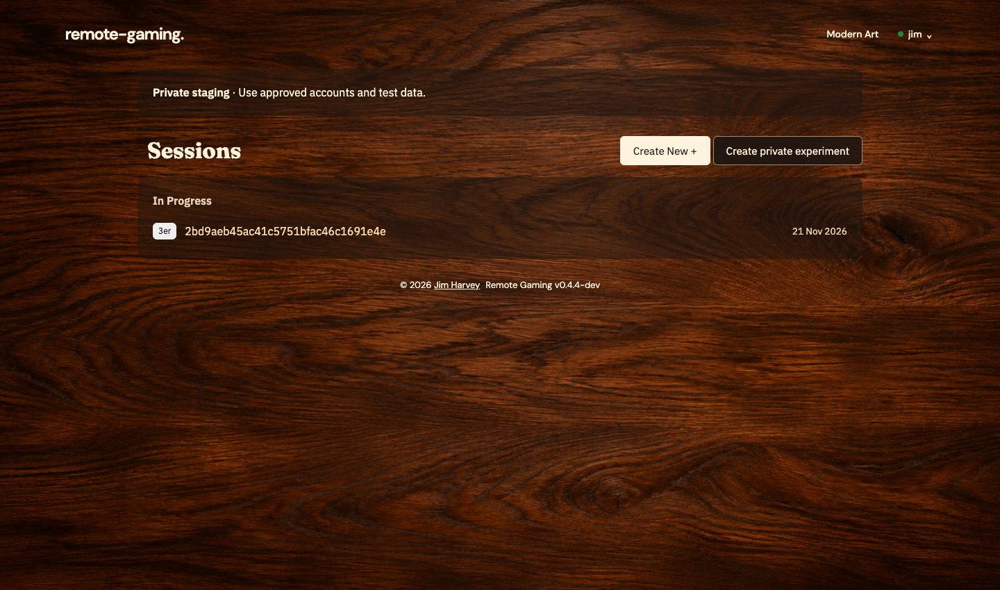](modern-art-lobby-desktop.png) |
| 390 CSS px | [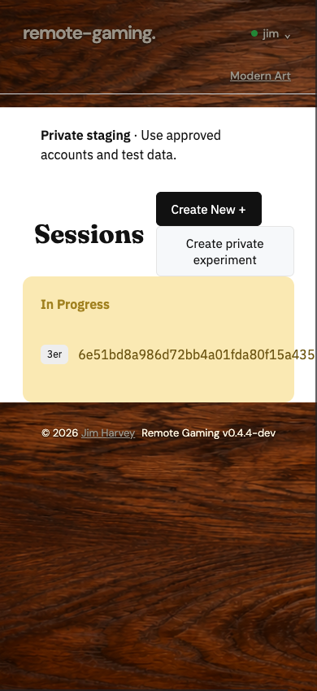](before-modern-art-lobby-mobile.png) |  |

## Modern Art tabletop

Authenticated disposable fixtures at the top of the page.

| Viewport | Before | Candidate |
| --- | --- | --- |
| 1440 CSS px |  | [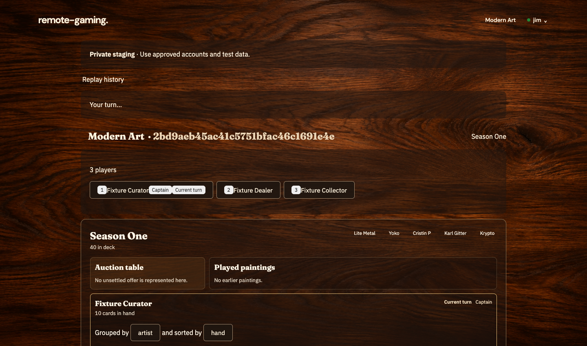](modern-art-tabletop-desktop.png) |
| 390 CSS px | [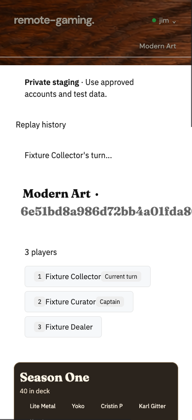](before-modern-art-tabletop-mobile.png) | [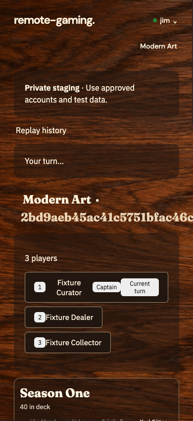](modern-art-tabletop-mobile.png) |

## Sticky navigation

Authenticated disposable tabletop fixtures after scrolling.

| Viewport | Before | Candidate |
| --- | --- | --- |
| 1440 CSS px |  | [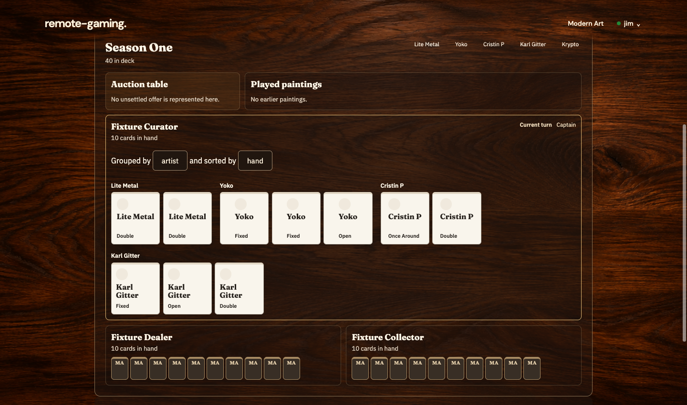](navigation-scrolled-desktop.png) |
| 390 CSS px | [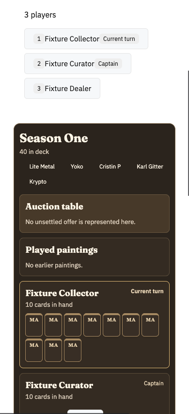](before-navigation-scrolled-mobile.png) |  |

## Account control

Authenticated disposable fixtures. `jim` is the verified username claim supplied by the fixture.

| Viewport | Hover | Expanded |
| --- | --- | --- |
| 1440 CSS px |  | [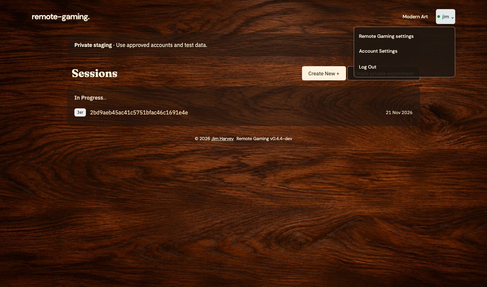](account-expanded-desktop.png) |
| 390 CSS px | [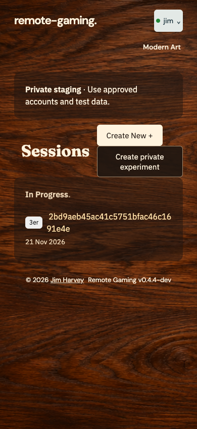](account-hover-mobile.png) |  |

## Pandemic status

Hosted staging captures.

| Viewport | Candidate | Candidate hover |
| --- | --- | --- |
| 1440 CSS px |  |  |
| 390 CSS px |  | [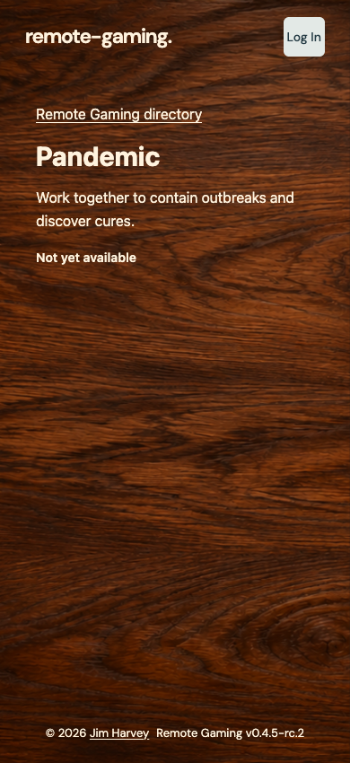](pandemic-status-mobile-login-hover.png) |

## Verification and release dependencies

- The candidate’s recorded application and Chrome suite passed 115 examples. Hosted Chromium checked the directory, Modern Art entry and Pandemic status at 320, 390, 700, 701 and 1440 CSS px. Browser accessibility checks covered keyboard focus and return, reduced motion, forced colors and disclosure in a short viewport. The candidate review recorded 39 passing Infrastructure Shell reference tests. [Candidate CI](https://github.com/harvj/remote-gaming/actions/runs/44959759471)
- The signed Shell baseline during capture was `v1.1.0`, which requires the header to leave the reading area on scroll. Infrastructure PR #8 merged at `46c9a088b907a7ebbe3626f71e1832f881e84da5` and adds selectable flow and sticky modes. This review records `header_scroll_mode=sticky`. The amendment requires scroll evidence for SH-01, including a content-only fade, reachable focus and anchors, and readable controls. SH-06 covers reduced motion, forced colors and unavailable effects. Production rollout requires acceptance against the applicable signed publication and owner visual approval. [Infrastructure PR #8](https://github.com/harvj/infrastructure/pull/8)
- Auth needs to supply a verified `preferred_username` through an approved staging identity channel. Remote Gaming accepts the claim from a validated ID token or approved, grant-bound Shell introspection. At capture time, live Auth discovery omitted the username claim and the Shell introspection mapping excluded staging. The account control displays `Signed in` when no verified name is supplied. [Auth discovery](https://auth.harvj.com/.well-known/openid-configuration) · [Auth Shell provider contract](https://github.com/harvj/auth/blob/6dcdca285346dc14749c5833ea1ba994d9297cac/docs/integrations/application-shell-v1.md)
