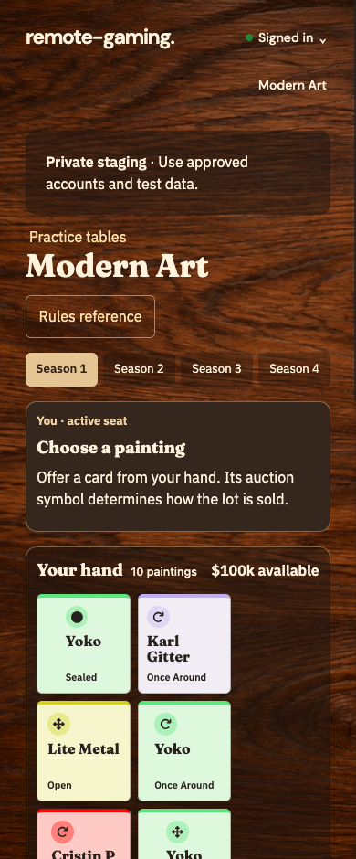
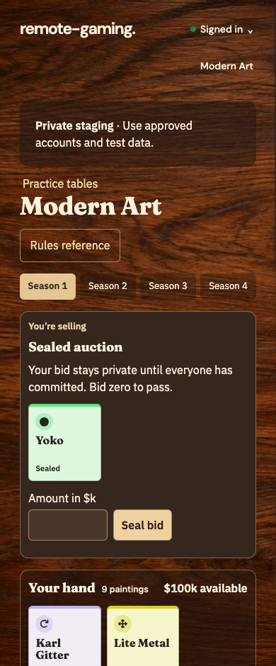
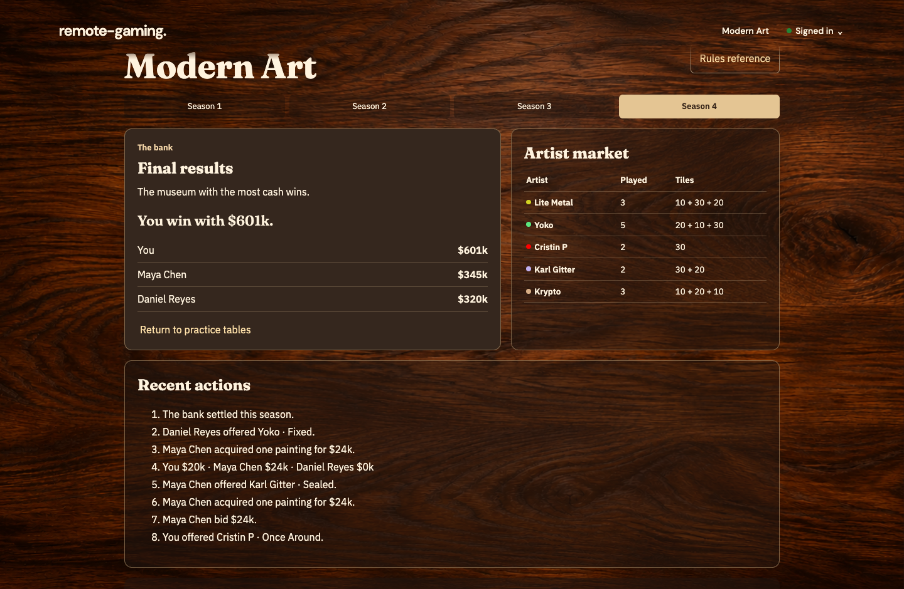

# P1.7 Modern Art practice

Owner-only practice tables run a three-seat Modern Art game against Maya Chen and Daniel Reyes. These Chromium captures use a disposable table, deterministic deal, a fixture Auth login, and the published oak artwork. Desktop is 1440 CSS px and mobile is 390 CSS px. Select a screenshot to open the full-resolution image.

| Phase | Desktop | Mobile |
| --- | --- | --- |
| Opening hand |  |  |
| Sealed bidding |  |  |
| Bank settlement | |  |
| Final results |  |  |

## Rules and staging operation

The legacy tabletop records card plays and observations from physical auctions. The practice table shares the original deck, artists, auction icons, and card styling. It adds digital bidding, private balances, season valuation, and deterministic settlement on a separate disposable table. The published rulebook supplies the auction and scoring rules. The practice adapter gives the owner the first offer, and a cashless fixed-price seller may offer at zero so the auction can progress. Hidden bids reveal together, and opponent hands and balances stay private until the rules call for disclosure. [Publisher’s Modern Art rulebook](https://www.cmon.com/wp-content/uploads/2023/06/MA_Rulebbok_Artbook_v18-low.pdf)

Sign into the staging Modern Art lobby as the owner and choose **Modern Art practice tables**. Start a table or resume one from the list. The table provides phase guidance and a separate rules reference. Use **Remove this disposable table** to delete its state and command history.

The practice link, routes, and Cable subscription require the designated private staging host, verified owner login, and staging opt-in. The feature uses its own table and does not affect an existing physical or historical session.
