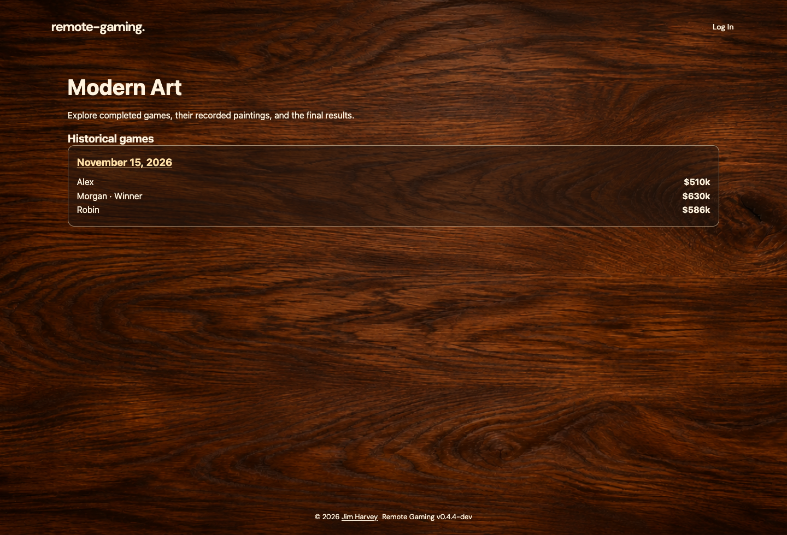
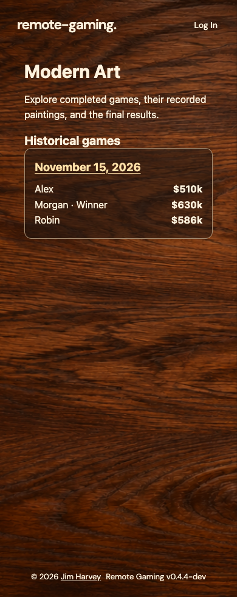
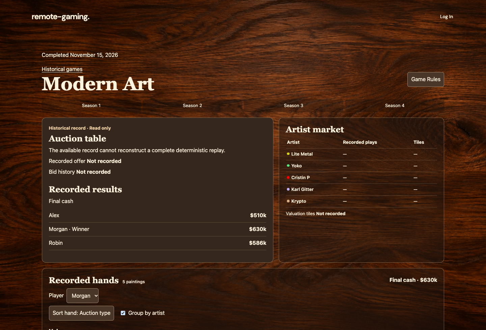
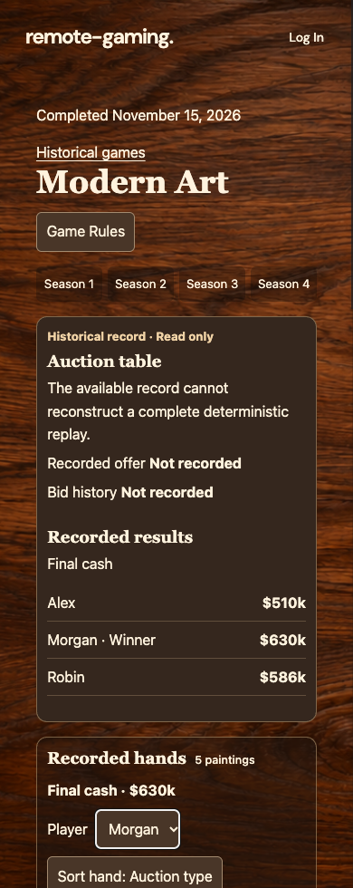

# Modern Art historical explorer

These Chromium captures use a disposable fixture with invented names and scores. No historical records are published here. Desktop uses 1440 CSS pixels and mobile uses 390.

| View | Desktop | Mobile |
| --- | --- | --- |
| Historical games |  |  |
| Recorded tabletop |  |  |
